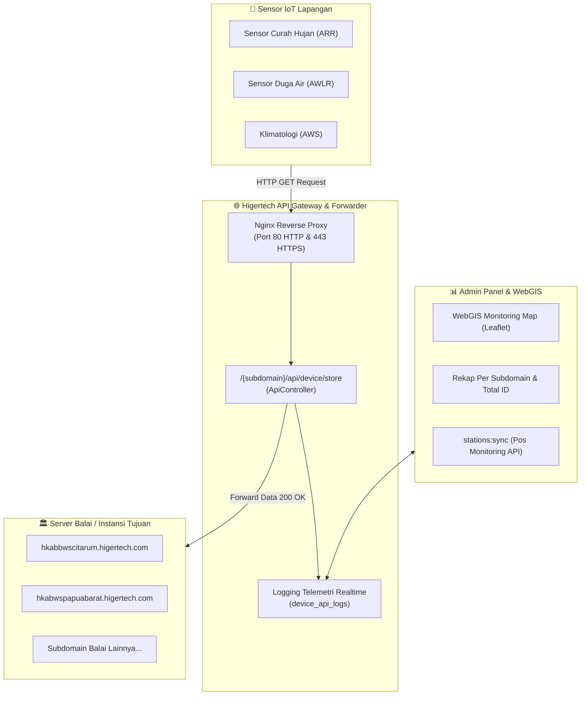

# 🌐 Higertech WebGIS & IoT Telemetry Platform

Platform WebGIS monitoring telemetri stasiun hidrologi, reverse proxy penangkap telemetri IoT perangkat lapangan, serta panel admin analitik terintegrasi untuk **PT Higertech Karya Sinergi**.

---

## ⚡ Cheatsheet: Perintah Cepat Harian

### 1. Sinkronisasi Data Stasiun & Telemetri (`stations:sync`)
Digunakan untuk menarik data **1.400+ stasiun pos riil** (pos hujan, duga air, klimatologi) beserta pembacaan telemetri sensor terbarunya dari server upstream Pos Monitoring (`http://103.183.75.71:5000`).

#### 💻 Di Komputer Lokal (Laragon / Native):
```bash
# Sinkronisasi normal (update stasiun yang ada & tambah stasiun baru):
php artisan stations:sync

# Bersihkan data stasiun dummy/seeder lama sebelum sinkronisasi:
php artisan stations:sync --wipe-dummy
```

#### 🐳 Di Server Production (VPS Docker):
```bash
# Sinkronisasi normal di dalam container PHP:
docker compose exec app php artisan stations:sync

# Bersihkan dummy lama lalu sinkronkan ulang:
docker compose exec app php artisan stations:sync --wipe-dummy
```

> **Catatan Otomatisasi:** Di production, Laravel Scheduler otomatis menjalankan `stations:sync` **setiap 15 menit sekali** di latar belakang (`routes/console.php`).

---

### 2. Menjalankan Aplikasi di Komputer Lokal

```bash
# 1. Jalankan backend Laravel (Port 8000)
php artisan serve

# 2. Jalankan frontend asset compiler / hot-reload (Terminal terpisah)
npm run dev

# 3. Build aset untuk rilis production
npm run build
```

Akses web:
* 🗺️ **Peta WebGIS:** [http://localhost:8000/map](http://localhost:8000/map)
* 📊 **Panel Admin:** [http://localhost:8000/admin](http://localhost:8000/admin) (Gunakan akun admin yang dikonfigurasi saat seeder)
* 📡 **Log Telemetri IoT:** [http://localhost:8000/admin/device-logs](http://localhost:8000/admin/device-logs)

---

## 🏗️ Fitur & Arsitektur Sistem



1. **🗺️ WebGIS Monitoring Map:**
   * Visualisasi sebaran stasiun telemetri di seluruh Indonesia via Leaflet & MarkerCluster.
   * Multi-basemap (OSM, Humanitarian, Topografi, Satellite).
   * Filter instansi, status online/offline, dan tipe stasiun (`ARR`, `AWLR`, `AWS`, dll.).
2. **🚀 IoT Telemetry Forwarder & Reverse Proxy (`ApiController`):**
   * Menangkap request GET sensor lapangan di format: `/{sub_domain}/api/device/store?id=HGTxxx&ch=...&tma=...`.
   * Meneruskan secara transparan (*reverse proxy*) ke subdomain balai tujuan (`{sub_domain}.higertech.com/api/device/store`).
   * Mencatat payload, durasi respon, IP gateway, dan status HTTP ke tabel `device_api_logs`.
3. **📊 Admin Analytics & Log Dashboard:**
   * Ringkasan Total Request, Diteruskan (Sukses), Gagal/Error, dan Total Subdomain.
   * **Statistik Per Subdomain Balai:** Jumlah ID alat terdaftar, request diteruskan, dan request error per instansi.
   * **Smart Search:** Pencarian case-insensitive (`Hgt177` == `HGT177`), filter instan per ID alat, dan deteksi format IP otomatis tanpa polusi IP modem.
   * Ekspor data log & rekap ke **CSV** (streamed) dan **PDF** (A4 Landscape).

---

## 💻 Panduan Instalasi Pertama Kali di Komputer Lokal

### Prasyarat
* PHP >= 8.4 (ekstensi: `pdo_mysql`, `mbstring`, `gd`, `zip`, `xml`, `intl`)
* Composer 2.x
* Node.js >= 20.x & npm
* MySQL 8.0 (Laragon / XAMPP)

### Langkah Setup:
```bash
# 1. Clone repository
git clone https://github.com/Alexaldi/map-higertech.git
cd map-higertech

# 2. Install dependensi backend & frontend
composer install
npm install

# 3. Salin file konfigurasi environment
cp .env.example .env
php artisan key:generate

# 4. Sesuaikan kredensial MySQL di file .env:
# DB_CONNECTION=mysql
# DB_HOST=127.0.0.1
# DB_PORT=3306
# DB_DATABASE=higertech
# DB_USERNAME=root
# DB_PASSWORD=

# 5. Jalankan migrasi dan seeder awal
php artisan migrate --seed

# 6. Tarik data stasiun riil (Pos Monitoring)
php artisan stations:sync --wipe-dummy

# 7. Build aset Vite
npm run build

# 8. Jalankan server lokal
php artisan serve
```

---

## 🐳 Panduan Pengoperasian di Server Production (VPS Docker)

Aplikasi di VPS berjalan di atas Docker Compose dengan arsitektur multi-container:
* `higertech_app` (PHP 8.4-FPM Alpine)
* `higertech_nginx` (Nginx 1.25 Alpine)
* `higertech_mysql` (MySQL 8.0)
* `higertech_redis` (Redis 7 Alpine)
* `higertech_queue` (Queue Worker)

### Lokasi di VPS:
```bash
cd ~/map-higertech
```

### Perintah Penting di VPS:

```bash
# 🔄 Update kode terbaru dari GitHub:
git pull origin master

# 🚀 Rebuild & Update container aplikasi:
docker compose build --pull app
docker compose up -d app

# 🗄️ Jalankan migrasi database baru:
docker compose exec app php artisan migrate --force

# ⚡ Bersihkan cache aplikasi & route:
docker compose exec app php artisan optimize:clear
docker compose exec app php artisan optimize

# 📦 Build aset frontend di server:
docker compose exec app npm run build

# 🔄 Restart container Nginx (misal setelah ubah konfigurasi SSL / default.conf):
docker compose restart nginx

# 📡 Tarik data stasiun terbaru secara manual di VPS:
docker compose exec app php artisan stations:sync

# 📋 Cek log container PHP / Error secara live:
docker compose logs -f --tail=100 app
```

---

## 🧪 Testing & Verifikasi Kode

Aplikasi dilengkapi dengan test suite otomatis berbasis PHPUnit & Pest:

```bash
# Jalankan seluruh test suite:
vendor/bin/phpunit

# Jalankan test khusus fitur Log Telemetri & Search:
vendor/bin/phpunit --filter=DeviceApiLog

# Jalankan test khusus rekap laporan:
vendor/bin/phpunit --filter=DeviceApiLogRecapTest
```

---

## 🔒 Keamanan & Hardening

* **Proteksi PHP2Shell (CVE-2026-109618 & CVE-2026-109619):** Image container menggunakan basis `php:8.4-fpm-alpine` terbaru dengan konfigurasi `expose_php = Off`.
* **Proteksi CSV Injection:** Semua sel data telemetri yang diekspor disanitasi terhadap formula Excel berbahaya (`=`, `+`, `-`, `@`).
* **Rate Limiting Ekspor:** Ekspor CSV dan PDF dibatasi per admin untuk mencegah pemborosan CPU & memori server.
* **HTTP Bypass untuk IoT:** Endpoint API telemetri (`/api/*`) melayani HTTP tanpa 301 redirect untuk kompatibilitas modem mikrokontroler sensor di lapangan, sementara halaman admin & publik diwajibkan menggunakan HTTPS Let's Encrypt.
